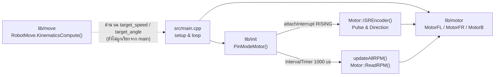

# Low-Level-Pruek (Teensy 4.1 Robot Firmware)

เฟิร์มแวร์ระดับ Low-Level สำหรับหุ่นยนต์ขับเคลื่อนแบบ **3-Wheel Swerve Drive** บนบอร์ด **Teensy 4.1** พัฒนาด้วย **PlatformIO** (Arduino Framework, C++17)

> **สถานะปัจจุบันของโปรเจกต์:** ระบบขับเคลื่อนมอเตอร์ (`Motor`), การอ่านค่า Encoder/RPM แบบ Real-time ด้วย Hardware Timer (`IntervalTimer`), และโครงสร้างคำนวณ Kinematics ของ 3-Wheel Swerve Drive (`move`) ถูกพัฒนาขึ้นแล้ว โดย `src/main.cpp` ในปัจจุบันเป็นโหมดทดสอบการหมุนของ `MotorFL` และอ่านค่า RPM ผ่าน Serial Monitor

---

## สารบัญ

- [ภาพรวมสถาปัตยกรรม](#ภาพรวมสถาปัตยกรรม)
- [โครงสร้างโปรเจกต์](#โครงสร้างโปรเจกต์)
- [การกำหนดขาใช้งาน (Pinout)](#การกำหนดขาใช้งาน-pinout)
- [รายละเอียดแต่ละโมดูล](#รายละเอียดแต่ละโมดูล)
- [Dependencies และสภาพแวดล้อม](#dependencies-และสภาพแวดล้อม)
- [การ Build, Upload และ Monitor](#การ-build-upload-และ-monitor)
- [สถานะการพัฒนาและจุดที่ต้องดำเนินการต่อ (TODO)](#สถานะการพัฒนาและจุดที่ต้องดำเนินการต่อ-todo)
- [เอกสารที่เกี่ยวข้อง](#เอกสารที่เกี่ยวข้อง)

---

## ภาพรวมสถาปัตยกรรม



---

## โครงสร้างโปรเจกต์

```text
Robot/
├── platformio.ini          # ตั้งค่าบอร์ด teensy41, build flags (-std=gnu++17) และ libraries
├── include/
│   └── robot.h             # Master header รวม Arduino.h, motor.h, init.h และ move.h
├── src/
│   └── main.cpp            # จุดเริ่มต้นโปรแกรม (setup / loop)
├── lib/
│   ├── init/               # กำหนดขา Pinout, ค่า PPR และตั้งค่า Interrupt / IntervalTimer
│   │   ├── init.h
│   │   └── init.cpp
│   ├── motor/              # คลาส Motor สำหรับควบคุม PWM/Direction และคำนวณ RPM
│   │   ├── motor.h
│   │   └── motor.cpp
│   └── move/               # คลาส move สำหรับคำนวณ Kinematics ของ 3-Wheel Swerve Drive
│       ├── move.h
│       └── move.cpp
├── test/                   # พื้นที่สำหรับ PlatformIO Unit Testing
└── MOTOR_OPTIMIZATION.md   # บันทึกแนวทาง Optimize คลาส Motor & Encoder RPM สำหรับ Teensy 4.1
```

---

## การกำหนดขาใช้งาน (Pinout)

กำหนดไว้ใน `lib/init/init.cpp` สำหรับมอเตอร์ทั้ง 3 ล้อ โดยใช้ค่า Encoder **PPR = 370**:

| ล้อ (Instance) | `DIR_1` (`MotorIN_A`) | `DIR_2` (`MotorIN_B`) | `PWM` (`MotorPWM`) | `ENCODER_IN_A` (Interrupt `RISING`) | `ENCODER_IN_B` |
| :--- | :---: | :---: | :---: | :---: | :---: |
| **Front Left (`MotorFL`)** | `2` | `1` | `0` | `14` | `15` |
| **Front Right (`MotorFR`)** | `4` | `5` | `3` | `17` | `16` |
| **Back (`MotorB`)** | `24` | `12` | `11` | `23` | `22` |

---

## รายละเอียดแต่ละโมดูล

### 1. ระบบตั้งค่าฮาร์ดแวร์ (`lib/init`)
ฟังก์ชัน `PinModeMotor()` ทำหน้าที่เตรียมระบบเมื่อเริ่มต้นทำงาน:
- ตั้งค่าความละเอียด PWM เป็น **10-bit** (`analogWriteResolution(10)` สำหรับช่วงค่า `0–1023`)
- กำหนดขาให้ `MotorFL`, `MotorFR`, `MotorB` พร้อมค่า `PPR = 370`
- ผูก External Interrupt แบบ `RISING` กับขา `ENCODER_*_IN_A` ของทั้ง 3 ล้อ เพื่อเรียก `ISREncoder()`
- ตั้ง `IntervalTimer encoderTimer` ให้เรียก `updateAllRPM()` ทุกๆ **1000 µs (1 ms)**

### 2. การควบคุมมอเตอร์และการวัดรอบ (`lib/motor`)
คลาส `Motor` (สร้าง Global Instances `MotorFL`, `MotorFR`, `MotorB`):
- **`drive(int16_t speed)`**: รับค่าความเร็วช่วง `-1023` ถึง `1023` (`constrain`) เพื่อควบคุมทิศทางผ่าน `MotorIN_A` / `MotorIN_B` และส่งสัญญาณ PWM ออกที่ `MotorPWM`
- **`ISREncoder()`**:
  - วัดคาบเวลาระหว่าง Pulse (`dt = micros() - PrevTime`) โดยกรองสัญญาณรบกวนที่เร็วกว่า `30 µs` (`if (dt < 30) return;`)
  - อ่านทิศทางจาก `digitalReadFast(EncoderIN_B)` และอัปเดต `MotorDirection` กับ `EncoderCount`
- **`ReadRPM()` / `updateAllRPM()`**:
  - คำนวณความเร็วรอบต่อนาที:
    `CurrentRPM = (int16_t)((60000000UL / (DeltaTime * ppr)) * MotorDirection)`
  - ตรวจจับการหยุดหมุนด้วย `Counter` (ค่า `MaxCounter = 30` รอบ Timer หรือ ~30 ms หากไม่มี Pulse ใหม่เข้ามา จะรีเซ็ต `CurrentRPM` และ `MotorDirection` เป็น `0`)

### 3. Kinematics สำหรับ 3-Wheel Swerve Drive (`lib/move`)
คลาส `move` (สร้าง Global Instance `RobotMove`) สำหรับคำนวณความเร็วและมุมของแต่ละล้อจากคำสั่งเคลื่อนที่ `(vx, vy, omega)`:

| ล้อ | `mount_angle` (องศา) | `offset_angle` (องศา) | `ROBOT_RADIUS` (เมตร) |
| :--- | :---: | :---: | :---: |
| **WheelFL** (Front Left) | `60.0f` | `0.0f` *(ค่าเริ่มต้น)* | `0.0f` *(ค่าเริ่มต้น)* |
| **WheelFR** (Front Right) | `-60.0f` | `0.0f` *(ค่าเริ่มต้น)* | `0.0f` *(ค่าเริ่มต้น)* |
| **WheelB** (Back) | `180.0f` | `0.0f` *(ค่าเริ่มต้น)* | `0.0f` *(ค่าเริ่มต้น)* |

เมธอด `KinematicsCompute(float vx = 0.0f, float vy = 0.0f, float omega = 0.0f)`:
- แตกองค์ประกอบความเร็วแต่ละล้อ:
  - `vx_wheel = vx - (omega * trackwidth_m)`
  - `vy_wheel = vy + (omega * wheelbase_m)`
- คำนวณ `target_speed` และ `target_angle` (ผ่าน `wrapAngle180()` เพื่อให้อยู่ในช่วง `[-180, 180]` องศา)

---

## Dependencies และสภาพแวดล้อม

กำหนดไว้ใน `platformio.ini` (Environment: `env:teensy41`):

- **Platform:** `teensy`
- **Board:** `teensy41` (Teensy 4.1)
- **Framework:** `arduino`
- **Build Flags:** `-std=gnu++17 -Iinclude` (ถอด `-std=gnu++14`)
- **Library Dependencies (`lib_deps`):**
  - `adafruit/Adafruit BNO055 @ ^1.6.3`
  - `adafruit/Adafruit Unified Sensor @ ^1.1.14`
  - `adafruit/Adafruit SSD1306 @ ^2.5.13`
  - `adafruit/Adafruit GFX Library @ ^1.11.9`
  - `adafruit/Adafruit NeoPixel @ ^1.12.3`

> **หมายเหตุ:** ไลบรารีใน `lib_deps` ข้างต้นถูกประกาศไว้ใน `platformio.ini` เพื่อเตรียมรองรับ IMU (BNO055), จอ OLED (SSD1306) และไฟสถานะ (NeoPixel) แต่ยังไม่ได้ถูก `#include` หรือเรียกใช้งานในโค้ด `src/` และ `lib/` ณ ปัจจุบัน

---

## การ Build, Upload และ Monitor

ใช้งานผ่าน [PlatformIO Core CLI](https://docs.platformio.org/en/latest/core/index.html) หรือ PlatformIO IDE ใน VS Code:

```bash
# คอมไพล์โปรเจกต์
pio run

# อัปโหลดเฟิร์มแวร์ลงบอร์ด Teensy 4.1 (ใช้ upload_protocol = teensy-cli)
pio run -t upload

# เปิด Serial Monitor ที่ Baud Rate 115200
pio device monitor
```

---

## สถานะการพัฒนาและจุดที่ต้องดำเนินการต่อ (TODO)

อ้างอิงจากโค้ดปัจจุบัน ยังมีส่วนที่ต้องปรับปรุงและเชื่อมต่อเพิ่มเติมก่อนนำไปใช้งานจริงเต็มรูปแบบ:

1. **ตั้งค่าพารามิเตอร์หุ่นยนต์จริงใน `lib/move/move.h`**: กำหนดค่า `ROBOT_RADIUS` (ปัจจุบันเป็น `0.0f`) และ `Offset_Angle_*` ให้ตรงกับโครงสร้างทางกายภาพ
2. **เชื่อมต่อค่าจาก `move` ออกไปยังระบบขับเคลื่อน**: ปัจจุบัน `WheelFL`, `WheelFR`, `WheelB` ยังเป็น `private` ใน `class move` และยังไม่มีส่วนที่นำ `target_speed` / `target_angle` ไปสั่งมอเตอร์ขับเคลื่อนและมอเตอร์หมุนมุมล้อ (Steering)
3. **เชื่อมต่อ IMU (BNO055) ใน `lib/move/move.cpp`**: ปัจจุบันค่า `yaw` ยังถูกกำหนดคงที่เป็น `0.0f` (`// TODO: ดึงค่า Yaw (องศา) จาก IMU ในอนาคต`)
4. **อัปเดต `src/main.cpp`**: เปลี่ยนจากลูปทดสอบ `MotorFL.drive(1023)` เป็น Control Loop หลักของหุ่นยนต์

---

## เอกสารที่เกี่ยวข้อง

- [MOTOR_OPTIMIZATION.md](MOTOR_OPTIMIZATION.md) — แนวทางการ Optimize โค้ด `Motor` และ `Encoder RPM` สำหรับ Teensy 4.1 (หมายเหตุ: ตัวอย่างโค้ดในเอกสารดังกล่าวแสดงโครงสร้างสำหรับ 4 ล้อ `MotorA`–`MotorD`)
